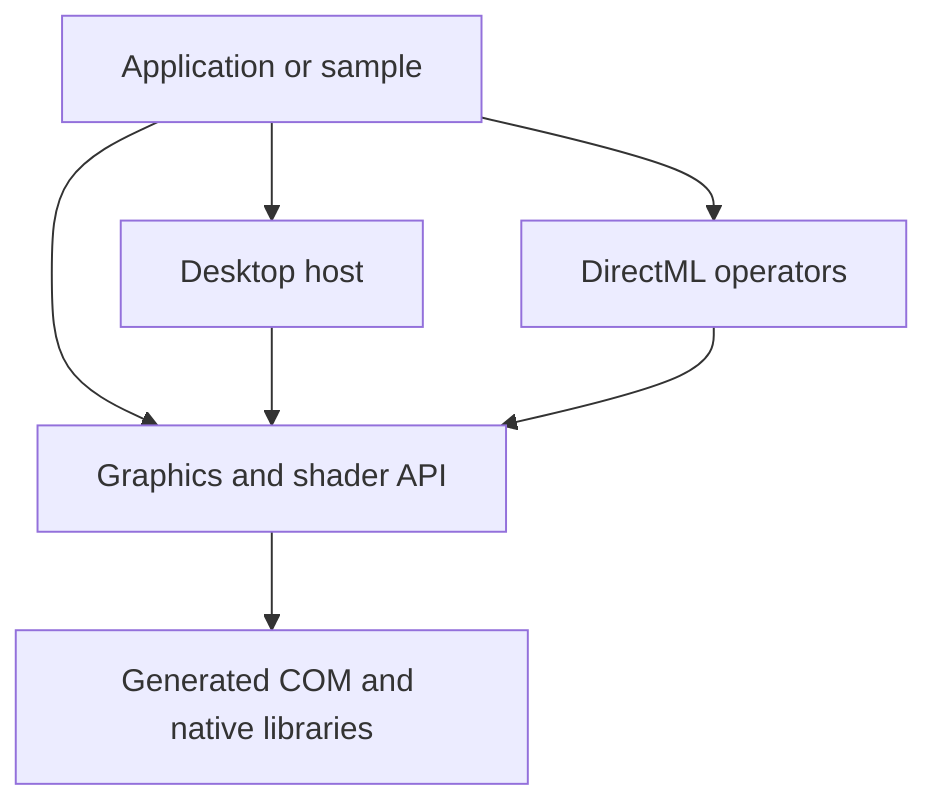

# DXSharp architecture and release contract

DXSharp is a Windows D3D12 SDK for .NET 10. The current graphics samples use the generated COM stack. The compatibility packages preserve the original RCW-based API and have their own dependencies and qualification.

## What the bindings do

1. **Describe the ABI.** [NativeMethods.txt](../src/DXSharp.Core/NativeMethods.txt) selects the Win32 metadata declarations used by Core. [NativeMethods.json](../src/DXSharp.Core/NativeMethods.json) keeps them internal and asks CsWin32 to emit source-generated COM declarations. Native HRESULTs and explicit COM out pointers let the ownership layer handle failure and transfer at the call site.
2. **Generate the calls.** CsWin32 supplies signatures, GUIDs, data layouts, and interface inheritance. .NET emits the COM vtable dispatch and marshalling code at compile time. `ShaderCompiler` also implements the native DXC include callback through a generated managed-to-native COM projection. Core and DirectML disable implicit runtime marshalling. [Microsoft's COM generation guide](https://learn.microsoft.com/en-us/dotnet/standard/native-interop/comwrappers-source-generation)
3. **Own the pointer.** [ComOwner](../src/DXSharp.Core/Interop/ComOwner.cs) adopts the reference returned by a successful call, holds it in a safe handle, and creates a unique `StrategyBasedComWrappers` projection. A scoped borrow pins the handle's lifetime for a raw call. Cloning acquires a separate native reference. Disposal releases the projection and the owned native reference. The manual vtable calls in this layer are the three `IUnknown` operations. [IFactory2Raw](../src/DXSharp.Core/Interop/Factory2Raw.cs) supplies a narrow generated signature for swap-chain creation so its returned native reference can be adopted directly.
4. **Keep recorded work alive.** A command list retains resources, heaps, pipelines and other dependencies as it records. Submission associates those leases with a fence value. Queue retirement releases them after completion. Callers still select resource states and synchronize conflicting access. A COM reference protects lifetime, while a barrier or fence orders work.
5. **Load and distribute native dependencies.** The loader resolves OS D3D12 and DXGI from the Windows system directory, and resolves DXC and DirectML from the application directory. The Agility path creates a local D3D12 device factory from the packaged runtime. NuGet transitive MSBuild targets copy the appropriate runtime files into build and publish outputs. The Linux qualification exercises a portable native COM fixture. The graphics runtime uses Windows.

## Package boundaries

| Layer | Current responsibilities |
| --- | --- |
| `DXSharp.Core` | Device and queue ownership, buffers and resource states, descriptors, pipelines, HWND swap chains, DXC, and a bounded DXR surface |
| `DXSharp.DirectML` | Same-device tensor binding and synchronous compiled Add and GEMM execution with optional fused ReLU |
| `DXSharp.Framework.Desktop` | A WinForms-owned STA loop, one or two fenced frame slots, resize, depth target, and presentation |
| `DXSharp`, `DXSharp.Dxc`, `DXSharp.Framework` | Compatibility types, RCWs, older wrappers and framework. BasicSample and the compatibility tests still exercise this path. |

### Release documentation

The modern package contract covers handwritten public and protected API declarations in Core, DirectML, and Desktop. The compiler rejects missing or malformed XML and unresolved references in those sources. NuGet verification checks for a parseable, nonempty XML file alongside each SDK library. Document ownership, synchronization, units, defaults, and failure conditions at the API boundary. Tutorials provide end-to-end examples.

The compatibility audit reported at least 3,945 missing comments at the qualified baseline. The compiler reported 3,649 in `DXSharp`, 21 in `DXSharp.Dxc`, and 275 in `DXSharp.Framework`. Existing pragmas suppress additional warnings. Before putting a compatibility package under the same gate, decide which APIs it will support, remove its scoped suppressions, and document and verify the retained surface.

### What can be retired

| Candidate | Evidence and release decision |
| --- | --- |
| Unused high-version generated interfaces | Narrow Core's metadata roots to the highest versions used by the implementation. The modern bindings are internal, so this reduces generated code without changing the public API. Keep the ABI and sample qualification on the resulting binary. |
| Old DXC archives and checked-in documentation output | The two 2023 DXC ZIPs and `doc/DXSharp.xml` account for about 54 MB in the checked-out tree. The current package pipeline restores a pinned DXC package and generates XML from source. Check any external consumers before removing these snapshots. Repository history retains old blobs after a normal deletion. |
| Backup DXC project and old build experiments | The backup project sits outside the solution. The older DevOps definitions and shader task experiments are historical candidates for a separate cleanup. Confirm their use in downstream builds first. |
| Legacy RCW packages | Keep the compatibility boundary explicit. The legacy shader builder and framework overlap with modern entry points, but existing callers and compatibility tests still reference them. Inventory public API and migrate the sample and downstream consumers before deprecating packages. |

## Next vertical slices

### Assets and rendering toolkit

Start with reusable upload batches, frame-local allocation, descriptors, and indexed mesh drawing. LitCube uses explicit vertex/index buffers and a typed input layout. The mesh upload path batches copies into a caller-owned direct command list, and submission retirement retains staging and draw dependencies. The Static Model Viewer loads a patrol scene through the portable `DXSharp.Assets` project. It shares uploaded geometry and base color textures across nodes. Meshes and sRGB textures can record into the same direct command list. The current texture API binds one view at a time. A shared descriptor allocator is the next dependency for multi-texture materials and large draw lists. Use [DirectXTK12's memory helpers](https://github.com/Microsoft/DirectXTK12/wiki/Memory-Management) as a reference for upload and retirement, and [MiniEngine's ModelViewer](https://github.com/microsoft/DirectX-Graphics-Samples/tree/master/MiniEngine/ModelViewer) as a reference workload for Sponza.

Make asset processing a build feature with an explicit item type, such as `DXSharpAsset`. Give assets stable logical IDs and declare kind, source, and build options. Process shaders, textures, and meshes offline into the project's intermediate directory, with dependencies and per-item inputs and outputs for incremental MSBuild. Publish cooked assets with a versioned manifest containing IDs, hashes, relative paths, and source/license information. Validate duplicate IDs, missing dependencies, and clean versus incremental output equivalence. Exercise the package from an external project. [MSBuild incremental targets](https://learn.microsoft.com/en-us/visualstudio/msbuild/how-to-build-incrementally)

After the static import path supports textured materials, use Sponza to measure lighting, material and texture coverage, frame time, and peak working set. Keep the sample's asset revision and license recorded with the manifest.

### Character animation and effects

Use glTF as the first runtime interchange format. Feed Houdini and Cascadeur exports through an offline conversion stage with explicit axes, units, joint order, and clip timing. Import the hierarchy, inverse bind matrices, joint indices, and normalized weights. Evaluate clips on the CPU, generate joint palettes, and upload a frame-owned palette for GPU skinning. Compare a small GPU-skinned fixture against CPU reference vertices before scaling to a complete character. Build IK on the pose and constraint data after that path is stable. [glTF 2.0 skinning specification](https://registry.khronos.org/glTF/specs/2.0/glTF-2.0.html#skins)

Build particle effects on the same storage and upload contracts. Let authored emitters produce compact records for simulation. Use GPU-resident buffers for simulation and rendering, with a deterministic seed and readback mode for tests. The current N-body sample provides a seeded compute/graphics reference on a single direct queue.

### Simulation and device scheduling

Use stable entity IDs and typed SoA chunks for hot components such as position, velocity, and transforms. Keep CPU kernels on contiguous spans, vectorize the hot loops, and compare scalar and SIMD outputs and throughput before adding a general job scheduler. Partition work by ranges with declared reads and writes.

Represent CPU jobs and GPU submissions as distinct dependency domains. Introduce GPU-side fence handoffs between compute, copy and graphics queues before adding a general workload graph. Keep upload and readback memory separate from default-heap working sets. A frame or ring allocation becomes reusable only after the last queue that consumes it has completed. Treat UMA or GPU upload heaps as adapter capabilities to qualify with measurements. [D3D12 readback and fence guidance](https://learn.microsoft.com/windows/win32/direct3d12/readback-data-using-heaps)

### Visual DirectML

Build an image-to-image sample with a deterministic convolution and activation chain. Show the input, processed image, and CPU/GPU error view side by side. Use small fixed fixtures for numerical comparison, then validate the same graph at interactive sizes. That slice needs convolution/graph compilation, a GPU texture-to-tensor path, and a way to display results from GPU-resident memory. Reuse the current DirectML validation pattern and reserve CPU readback for checks, diagnostics, and capture.

### Embedding and presentation

Split frame-slot management and presentation from the WinForms message loop. Define host responsibilities for scheduling, physical pixel size and DPI, visibility, input, and surface recreation. Keep frame submission and resource retirement under the renderer.

| Host | First integration path |
| --- | --- |
| WinUI 3 | A composition swap chain attached to a `SwapChainPanel` on its UI thread |
| WPF | An HWND swap chain inside `HwndHost`, with the child window's airspace documented |
| Avalonia | A Windows sample using `NativeControlHost` and a child HWND |
| Headless | The same renderer into offscreen targets with readback and no UI dispatcher |

Qualify resize, DPI changes, host teardown, and device removal in each adapter. Embedded WinUI composition is a separate surface kind from the HWND swap chain available today. [WinUI SwapChainPanel](https://learn.microsoft.com/windows/windows-app-sdk/api/winrt/microsoft.ui.xaml.controls.swapchainpanel) · [WPF HWND hosting](https://learn.microsoft.com/dotnet/desktop/wpf/advanced/hosting-win32-content-in-wpf) · [Avalonia native Windows controls](https://docs.avaloniaui.net/docs/platform-specific-guides/windows)

## Qualification evidence

The baseline was qualified with Windows and Linux native interop, Windows WARP samples, and NuGet consumption in GitHub Actions. The supplied Azure run shows Windows Debug, Windows Release, and Linux native interop succeeded with seven published artifacts at `9897953`. On the RTX 3080 Ti, the supplied console output verifies the DXC compute readback and the DXR hit and miss pixels. The N-body screenshot shows the 1,024-body window running on the same adapter. The hardware compute log covers the shader dispatch path. DirectML Add and GEMM have WARP evidence from CI.

## Toolkit parity

| Capability | Qualified or usable path | Next implementation |
| --- | --- | --- |
| Upload and memory helpers | Caller-owned mesh and single-mip RGBA uploads with fence-retained staging | Reusable upload pages, descriptor arenas, batched texture subresources, deferred recycling |
| Texture and material workflow | Embedded glTF PNG/JPEG base color, sRGB SRVs, indexed static meshes | DDS/WIC/TGA and BC formats, mip chains, sampler variants, metallic-roughness and normal maps |
| Model and content workflow | Source-tree static asset library and MSBuild build/publish staging | Versioned incremental cooker, portable manifests, dependency tracking, FBX ingest, skeletons and animation |
| Draw helpers | Typed vertex streams, instancing, depth, and sample-local HUD and effects | Shared sprite, font and primitive batches, standard effects and pipeline presets |
| Game framework | Windows desktop loop, resize handling, sample-local music and selection | Input and audio toolkit APIs, embeddable hosts, reusable time and frame services |
| Interop breadth | Generated COM and native lifetime qualification for the modern path | Inventory the legacy API by subsystem, add missing bindings and verify ABI and lifetime on supported architectures |

Use the [DirectXTK12 component list](https://github.com/microsoft/DirectXTK12#documentation) to track toolkit capabilities and the legacy DXSharp surface to track native API coverage. Keep those acceptance criteria independent. A qualified asset workflow should ingest an authored scene, build it incrementally, package it, and render it from the packaged output on a clean consumer project.
